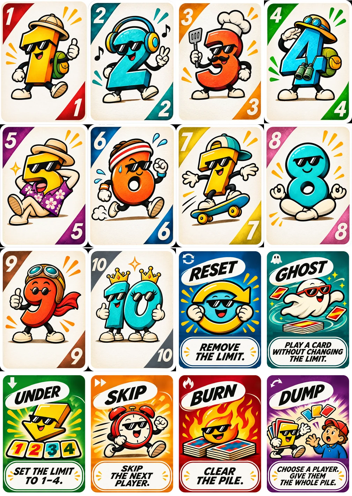

# STACK

**A physical-first card game, brought to life in the browser.**

STACK is an original, 54-card shedding game for 2–5 players. It combines a printable deck, fast tactical interruptions, bot opponents and private online multiplayer. The browser experience is built to feel like playing with real cards, while the rules engine remains the source of truth.

[**Try the Classic tabletop**](https://stack-card-game-t7vx.onrender.com/pilehead/index.html) · [**Explore the React tabletop**](https://stack-card-game-t7vx.onrender.com/play) · [**See the deck gallery**](https://stack-card-game-t7vx.onrender.com/pilehead/gallery.html) · [**Read the engineering case study**](docs/CASE-STUDY.md)

> **Project status:** Active product/playtest project, not a commercial release. Hosted demo availability and real-device multiplayer acceptance must be verified separately from automated tests. The Render free tier may sleep between visits.



*One of STACK's selectable deck designs. These are actual project card assets, not a screenshot of the game UI.*

## The game

Every player starts with three hidden cards, three face-up cards and three in hand. Play cards onto the central pile, draw from the stock, work through your remaining layers and avoid being the last player left.

The 54-card deck has 40 number cards (1–10, four of each) and six kinds of action cards: RESET, GHOST, UNDER, SKIP, BURN and DUMP. **SNAP** lets players immediately play a matching card just drawn from the stock; **SLAM** rewards completing four of a kind, including out-of-turn interruptions. DUMP lets you send the existing pile to a chosen opponent. A configurable **Final Duel** rule can accelerate two-player endgames and is off by default.

### Ways to play

- **Classic tabletop:** a mobile-friendly, tactile card table with solo bots, local play and online rooms.
- **React tabletop:** an alternative Next.js/TypeScript interface with event-driven motion and responsive presentation.
- **Private multiplayer:** 2–5 seats, with supported human/bot combinations, private hand information, reconnect and same-room rematches.
- **Official playtest kit:** [printable rules and facilitator materials](dist/pilehead/playtest.html), deck gallery, printable cards and local-only playtest feedback.
- **Game balance lab:** deterministic simulations for exploring rules and endgame behavior.

## Why it's an engineering project

| Area | Implementation |
| --- | --- |
| **Game engine** | Shared deterministic JavaScript engine, validated moves, bots and reproducible simulations |
| **Client** | Classic vanilla JS/CSS tabletop plus a Next.js 16, React 19 and TypeScript tabletop |
| **Multiplayer** | Server-authoritative room API, revision-based concurrency control and private player views |
| **Real-time** | Authenticated WebSocket room updates and reactions, with HTTP polling fallback |
| **Persistence** | Neon PostgreSQL for rooms, seats and session state |
| **Deployment** | One Node.js 24 service on Render, serving both frontends and the same-origin API |
| **Quality** | Automated engine, rules, multiplayer, privacy, responsive/browser and deployment regression checks |

**A key design constraint:** animations cannot change game outcomes. Card moves are committed by the engine or server first; visual effects render the resulting events. This matters particularly for time-sensitive SNAP and SLAM interactions.

Read the [architecture overview](docs/ARCHITECTURE.md), [engineering case study](docs/CASE-STUDY.md) and [playtest rules](docs/pilehead-design.md).

## Run locally

**Requirements:** Node.js 24 and npm.

```bash
git clone https://github.com/yotamon/spark-card-game.git
cd spark-card-game
npm ci
npm test
npm run build
node scripts/render-server.cjs
```

Open `http://localhost:10000/pilehead/index.html` for Classic or `http://localhost:10000/play` for the React tabletop. Local bot play does **not** require database credentials. Hosted/private rooms do.

For independent React UI development:

```bash
npm ci --prefix apps/web
npm run dev --prefix apps/web
```

See [`apps/web/README.md`](apps/web/README.md) for the local API origin setup, and [`docs/render-hosting.md`](docs/render-hosting.md) for server configuration. **Never commit `PILEHEAD_DATABASE_URL` or other credentials.**

## Repository guide

```text
apps/web/                  Next.js + TypeScript tabletop
dist/pilehead/             Classic tabletop, original cards and shared game engine
api/pilehead.js            Authoritative online room commands and state
scripts/render-server.cjs  Single-origin Node server
scripts/realtime-hub.cjs   WebSocket room updates
scripts/                   Build, production probes and simulations
tests/                     Engine, privacy, UX and integration regressions
docs/                      Rules, architecture, experiments and release notes
render.yaml                Render service blueprint
```

The `dist/pilehead/` directory contains **maintained source code**, despite its historical name. Build output goes into the ignored `vercel-static/` folder. Existing `/pilehead/` URLs and internal `PILEHEAD` identifiers are retained for compatibility.

## Development and verification

```bash
npm test                            # Project regression suite
npm run build                       # Classic + Next static export
npm run typecheck --prefix apps/web # React TypeScript check
npm run simulate -- 120 4 20261113  # Reproducible bot simulation
```

GitHub Actions additionally exercises browser interactions and integrated HTTP/WebSocket scenarios. **Passing automated checks does not mean a live deployment, accessibility audit or two-device physical playtest has passed.** See the [release runbook](docs/stack-motion-ux-release.md).

## About the project

STACK is an independent game-design and full-stack product-development project by [Yotam](https://github.com/yotamon), exploring how physical game mechanics translate into intuitive, fair and expressive digital multiplayer experiences.

For the product story, technical decisions and trade-offs, start with the [case study](docs/CASE-STUDY.md). Before making the repository public, review the [publication checklist](docs/PUBLIC-RELEASE-CHECKLIST.md).

**Code and artwork licensing:** No open-source license is currently granted. Unless stated otherwise, all rights are reserved.
